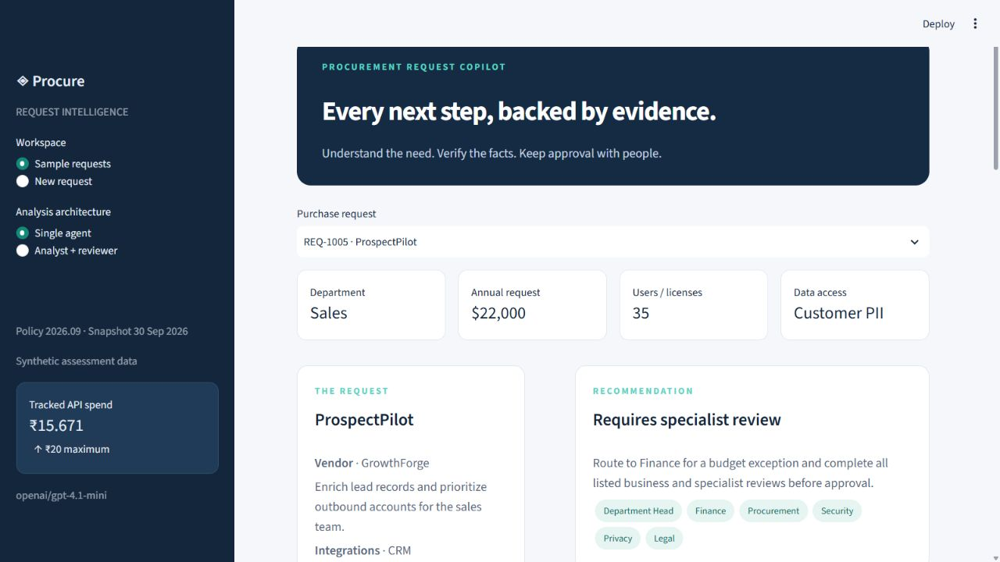
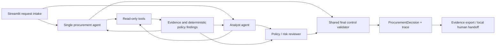

# Procurement Request Copilot

An internal procurement copilot that turns a purchase request into an evidence-backed next action. AI interprets the need, code enforces policy, and humans own approvals and exceptions.

Built for FDE Assessment 3 with the supplied synthetic starter pack. This is a local assessment product, not an authenticated enterprise approval system.



## Setup and one-command start

Requires Python 3.12 (3.11 also supported), internet access for installation and model calls, and an AICredits key with access to `openai/gpt-4.1-mini`.

```powershell
python -m venv .venv
.\.venv\Scripts\python.exe -m pip install -r requirements.txt
Copy-Item .env.example .env
# Set OPENAI_API_KEY in .env. Keep the key local.
.\.venv\Scripts\python.exe verify_setup.py
.\.venv\Scripts\python.exe run_local.py
```

With the virtual environment activated, the start command is simply:

```sh
python run_local.py
```

Open **http://127.0.0.1:8501**. The launcher also starts the mock vendor-risk API on port 8001, waits for service readiness, and terminates children when stopped with Ctrl+C. Both services bind to localhost. Configure `.env` before starting. Existing OS environment variables take precedence.

For macOS/Linux use `python3 -m venv .venv`, `source .venv/bin/activate`, and the equivalent `python -m pip` commands.

## Product workflow

1. Select one of ten sample requests or enter a new request with requester, cost, users, data access and integrations.
2. Run either the single-agent or staged analysis.
3. Inspect the recommendation, required approvals, missing information and risk flags. Evidence is grouped by tool and includes record or policy references.
4. Export the complete review packet, including request snapshot and agent/tool traces.
5. Record a local handoff with reviewer notes. This does not approve spend or purchase anything.

Editing a request or switching architectures invalidates the displayed analysis. Results survive ordinary UI reruns. Custom requests use the same tools and controls as evaluation requests.

## Architecture and control boundary



**Single:** model selects read-only tools; tools execute; the same model generates its analysis; code validates and assembles the final recommendation. Normally two model calls.

**Staged:** the same analyst flow is followed by a separate reviewer model call receiving the analyst analysis, raw tool evidence and policy. Normally three model calls. This is an actual second reasoning stage, not an alias for the single architecture.

Both variants have identical tools, model, policy engine and output validation. A model's missing tool calls are explicitly completed by the application and recorded in traces. Tools execute at most once per run. JSON validation permits one bounded repair call per response; failure remains visible as a degraded run. The final public evidence items are generated by tools, rather than trusting model-written factual findings.

### Tools

| Tool | Evidence and checks |
|---|---|
| `request_and_budget` | Employee/department, completeness, annual cost and available-budget comparison |
| `software_and_history` | Same product/vendor/category catalog records, scope, seats and past purchases |
| `vendor_evidence` | Internal vendor registry plus HTTP mock-risk evidence and availability |
| `policy_checks` | Authoritative policy text, financial thresholds, review freshness and specialist routing |

The assessment entrypoint remains `src.solution.handle_request(request_id, architecture="single")`. It returns a Pydantic `ProcurementDecision` compatible with the original contract. `handle_custom_request` supports user-entered requests. Extra telemetry fields are backward-compatible.

## Policy assumptions

- Policy version **2026.09** and snapshot **2026-09-30** are authoritative for this synthetic assessment. Computer date is not used for expiry checks.
- A review exactly 365 days old is current; age greater than 365, missing/invalid dates and future dates require review.
- Annual costs are USD. Exactly $1,000 / $10,000 / $25,000 use the lower approval band. Zero is a valid explicitly entered cost; missing cost is not zero.
- Department comes from the employee registry. Budget is the available snapshot amount, not annual allocation.
- An empty integration list means none; unknown data access or malformed material input requires clarification.
- Licensed seats do not establish unused capacity. Shared-vendor records are surfaced, but only same-category or same-product matches are treated as functional substitutes. A software license does not replace training services.
- Sensitive reviews take precedence over catalog comparison in the primary next action. All approvals remain listed.
- Existing vendor approval or prior purchase does not authorize a new sensitive use case. Conflicting internal/external security status is not silently resolved.
- Vendor-wide personal-data processing alone does not prove the requested use processes PII; request data class and explicit purpose govern use-specific privacy routing.
- The model interprets credible gaps. Generic task tracking already covered company-wide is not itself a gap. Ambiguous add-on capacity permits either an existing-capacity review or routing to the required Manager approval; this is documented in the evaluation oracle.

## Reliability and spend

Requester text, catalog descriptions and vendor notes are untrusted data. Four empty-argument tool schemas bind retrieval to the application-owned request. No purchase, spend-approval, budget-edit, legal-acceptance or arbitrary execution tool exists. Explicit injection patterns are flagged; system instructions and deterministic policy remain authoritative. Pattern detection is not claimed to catch every possible injection.

Unavailable risk evidence adds a risk flag and Security/manual routing. Invalid JSON, unsupported evidence references, provider errors or exhausted budget are not counted as successful live-agent runs. UI shows the degraded status. Raw model JSON and repairs are saved in traces for diagnosis.

A SQLite ledger reserves estimated maximum call cost atomically before inference and settles using provider-reported tokens. Failed calls retain their reservation when billing is uncertain. It is shared across UI, probes and evaluations and caps this implementation at **INR 20**. Rates are fetched from AICredits and cached for the session; token estimates include protocol overhead. The provider token's own INR 20 budget is the authoritative external ceiling. Do not delete the spend ledger to bypass the limit. Cache-disabling is requested with `no_cache=true`; upstream behavior cannot be independently guaranteed.

Runtime records and secrets are ignored by Git. The included evaluation traces contain only supplied synthetic records and model outputs. No credential values are included.

## Evaluation and verification

```sh
python -m pytest -q
python verify_setup.py
python evals/run_public_evals.py --architecture single
python evals/run_public_evals.py --architecture staged
python evals/compare.py
```

`compare.py` prioritizes all six public cases, then four additional supplied cases. It alternates architecture order by request, uses the same fixed model and settings, records real calls/tokens/latency, and writes `evals/results/comparison.csv`, `summary.json`, and per-case traces. `--public-only` restricts the live suite to the six official cases. Re-running paid evaluations consumes remaining API budget.

The provided public harness checks only minimum requirements and can pass a safe degraded decision. Our comparison additionally requires actual agent-stage completion, supported citations, tool-generated evidence equality, human authority and an independently declared acceptable workflow label. It exits nonzero on failure. Golden labels are test-only and never used by the product implementation.

Tests cover threshold and budget boundaries, 365-day expiry, invalid requests, security/privacy/legal routing, conflicts and outages, injection, malformed JSON, false evidence references, distinct agent stages, human controls, persisted UI state, new-request intake and spend reservations. Deterministic/mocked tests incur no model charges.

Measured comparison results and the ship decision are in [the evaluation report](docs/evaluation_report.md) and [the decision memo](docs/architecture_decision.md). Earlier development-pass summaries are retained in `evals/development/`; the current report uses the final implementation only.


### Final measured comparison

| Metric | Single | Staged |
|---|---:|---:|
| Full cases passed | 10/10 | 10/10 |
| Mean latency | 5.76s | 8.66s |
| Mean model calls | 2.0 | 3.1 |
| Final-suite cost | INR 1.9607 | INR 3.4039 |

**Ship decision: single agent.** Both met the same final correctness and grounding checks; single used fewer calls, less time and lower cost. The ten synthetic cases with one observation each do not establish production reliability. All 59 automated tests and starter preflight checks passed.

## FDE delivery notes and limitations

The customer outcome is a review-ready procurement packet with an explicit owner and next action. Evidence references make decisions inspectable; failure handling keeps uncertainty visible. We measure analysis time and correctness, not unverified employee productivity savings.

This small synthetic test set does not establish production reliability or statistical superiority. Semantic catalog matching is primarily product/vendor/category based; cross-category functional discovery remains limited. The policy engine is deliberately explicit and must be reviewed when the policy changes. No real budget is reserved, and no real purchase is executed.

A production pilot needs SSO/RBAC, authenticated reviewer identity, immutable audit storage, concurrency controls for handoffs, data-retention policy, live source refresh, secrets management and customer-owned approval integrations.

See [the demo runbook](docs/demo_runbook.md) for a short walkthrough. Public GitHub publication and Google Form submission require access to the user's accounts.

## Screenshots

[Evidence panel](docs/screenshots/evidence.jpg) · [Verified local handoff](docs/screenshots/handoff.jpg)
